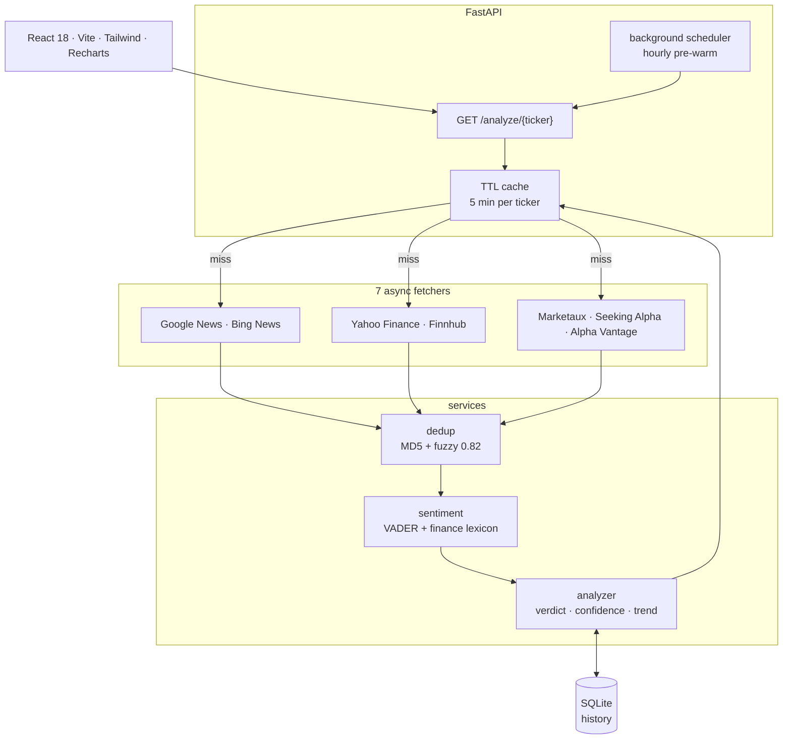
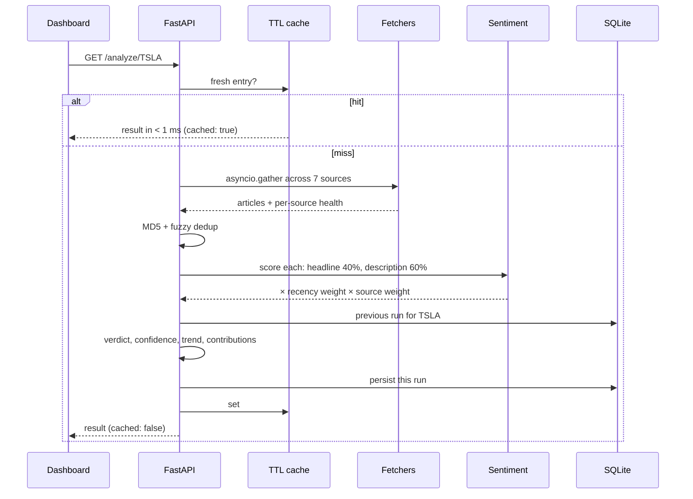

# Stock Sentiment Analyzer

**News from seven sources, scored by a finance-tuned sentiment model, turned into one BUY / SELL / HOLD verdict — with every source's contribution on show.**

[](https://github.com/guru-bharadwaj20/Sentiment-Stock-Analysis/actions/workflows/ci.yml)
[](backend/requirements.txt)
[](backend/main.py)
[](frontend/package.json)
[](backend/tests)
[](docker-compose.yml)
[](LICENSE)

Type a ticker. The backend fetches news from seven sources in parallel,
fuzzy-deduplicates repeated stories, scores each article with a VADER model
extended for finance, and aggregates everything into a verdict with a confidence
score, a trend against the last run, and a per-source breakdown — typically 5–10 s
on first fetch and under 1 ms from cache. No API keys required.

<p align="center">
  
  
</p>
<p align="center">
  
  
</p>

---

## Contents

| Section | |
|---|---|
| [What it does](#what-it-does) | The feature surface, by area |
| [Architecture](#architecture) | Fetch, dedupe, score, aggregate, persist |
| [How a ticker is analysed](#how-a-ticker-is-analysed) | Cache, fetchers, verdict |
| [Quick start](#quick-start) | Docker or local |
| [Methodology](#methodology) | Thresholds, source weights, confidence |
| [Project status](#project-status) | What CI proves, and the known limits |
| [Design decisions](#design-decisions) | The tradeoffs, and why |
| [Reference](#reference) | API and environment |
| [Repository layout](#repository-layout) | Where things live |
| [Team](#team) | Who built it |

---

## What it does

| Area | Capabilities |
|---|---|
| **Fetching** | `httpx.AsyncClient` + `asyncio.gather` across Google News, Bing News, Yahoo Finance, Finnhub, Marketaux, Seeking Alpha and Alpha Vantage, with per-source health and timing |
| **Deduplication** | MD5 exact hash, then `SequenceMatcher` fuzzy match at 0.82 |
| **Sentiment** | VADER with 40+ finance terms added; headline 40% / description 60%; FinBERT via `SENTIMENT_MODEL=finbert` |
| **Verdict** | Strong Buy to Strong Sell from mean weighted sentiment, with reasoning |
| **Confidence** | Six factors: magnitude, consensus, volume, source quality, recency, stability |
| **Trend** | Improving / deteriorating / stable against the last SQLite entry for the ticker |
| **Scheduler** | Hourly background refresh of pre-warmed tickers, skipping cache-fresh ones |
| **Dashboard** | Verdict card, analytics, charts, source contribution table, headlines, dark mode, recent searches |
| **Export** | JSON, CSV and print-to-PDF, entirely client-side |

---

## Architecture



---

## How a ticker is analysed



---

## Quick start

```bash
# Docker — frontend :3000, API :8000, Swagger :8000/docs
git clone https://github.com/guru-bharadwaj20/Sentiment-Stock-Analysis
cd Sentiment-Stock-Analysis
docker compose up --build
```

Or locally, in two terminals:

```bash
# backend
cd backend
python -m venv venv && source venv/bin/activate   # Windows: venv\Scripts\activate
pip install -r requirements.txt
uvicorn main:app --reload                         # http://localhost:8000

# frontend
cd frontend && npm install && npm run dev         # http://localhost:5173

# tests
cd backend && pip install -r requirements-dev.txt && pytest tests/ -v
```

---

## Methodology

| Mean weighted sentiment | Verdict |
|---|---|
| > 0.20 | Strong Buy |
| 0.05 – 0.20 | Buy |
| −0.05 – 0.05 | Hold |
| −0.20 – −0.05 | Sell |
| < −0.20 | Strong Sell |

| Source | Weight |
|---|---:|
| Finnhub | 1.00 |
| Alpha Vantage | 0.95 |
| Yahoo Finance | 0.90 |
| Seeking Alpha | 0.85 |
| Google News | 0.80 |
| Bing News · Marketaux | 0.75 |

**Confidence** (0–100) combines signal magnitude (35%), consensus (25%), article
volume (15%), source quality (10%), recency (10%) and stability (5%).

---

## Project status

Feature-complete for its scope.

### What CI proves on every push

| Stage | Proves |
|---|---|
| Lint → test | The backend lints and its 42 pytest cases pass |
| Build | Backend and frontend images build |
| Smoke test | The built stack starts and answers |

| Known limit | Detail |
|---|---|
| Single instance | The in-process cache and SQLite do not scale horizontally |
| No auth or rate limiting | Not for public exposure without a reverse proxy |
| Headlines only | Sentiment reads headlines and descriptions, not article bodies or prices |
| Free-tier sources | They can rate-limit or time out — which is why per-source health is in every response |

---

## Design decisions

**Async fan-out with one connection pool.** `httpx` + `asyncio.gather` makes seven
sources cost about as much as the slowest one, and a failed source degrades the
answer rather than failing it.

**VADER plus a finance lexicon, FinBERT optional.** FinBERT is 100–500× slower
without a GPU; VADER at ~1 ms per article is fast enough to score everything,
and the 40+ added terms cover the finance vocabulary it lacks.

**Cheap dedup first.** An exact hash catches most repeats instantly; a fuzzy match
at 0.82 catches the same story re-titled by another outlet.

**SQLite and an in-process cache.** Single-file, zero-ops storage is enough for
trend history, and a TTL dict is zero-latency and correct at one worker — Redis
would be overkill.

**Show the working.** Every verdict comes with each source's article count,
average sentiment and contribution share, so a reader can see what moved it.

---

## Reference

**`GET /analyze/{ticker}`** — full analysis, cached for 5 minutes per ticker:

```json
{
  "ticker": "TSLA",
  "verdict": "BUY",
  "confidence_score": 64.3,
  "trend": { "direction": "improving", "sentiment_delta": 0.0842 },
  "source_contributions": { "Finnhub": { "articles": 8, "avg_sentiment": 0.42, "contribution_pct": 31.2 } },
  "stats": { "bullish": 22, "bearish": 6, "neutral": 3 },
  "cached": false
}
```

Also: `GET /history/{ticker}`, `DELETE /cache`, `GET /scheduler/status`.

| Variable | Default | Description |
|---|---|---|
| `CACHE_TTL` | `300` | Cache TTL in seconds |
| `SCHEDULER_ENABLED` | `true` | Background refresh |
| `SCHEDULED_TICKERS` | `TSLA,AAPL,...` | Tickers to pre-warm |
| `SENTIMENT_MODEL` | `vader` | `vader` or `finbert` |
| `VITE_API_URL` | `http://localhost:8000` | Backend URL for the frontend |

---

## Repository layout

```
.
├── backend/
│   ├── main.py · config.py · scheduler.py
│   ├── api/routes.py         /analyze, /history, /cache, /scheduler/status
│   ├── models/schemas.py     Pydantic v2 response models
│   ├── fetchers/sources.py   the 7 async fetchers
│   ├── services/             analyzer, sentiment, cache, dedup
│   ├── db/history.py         SQLite persistence
│   └── tests/                42 pytest cases
├── frontend/src/
│   ├── hooks/                useAnalysis, useTheme, useRecentSearches
│   ├── services/api.js
│   └── components/           search, sidebar, dashboard cards, charts, headlines
└── docker-compose.yml
```

---

## Team

| Member | Focus |
|---|---|
| **Guru R Bharadwaj** | Backend, sentiment model, dashboard, CI — [GitHub](https://github.com/guru-bharadwaj20) · [LinkedIn](https://www.linkedin.com/in/guru-r-bharadwaj/) |

---

## License

[MIT](LICENSE).
